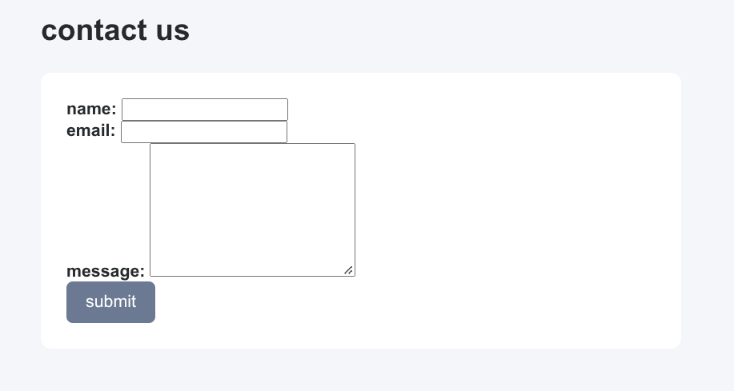
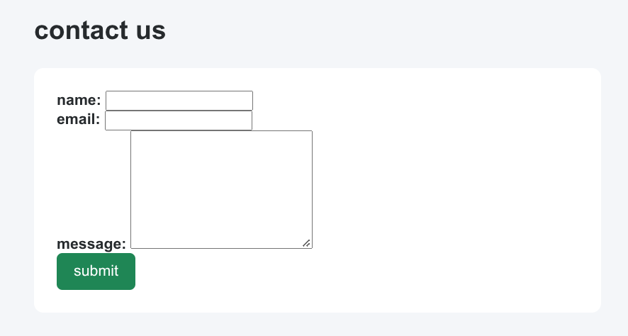
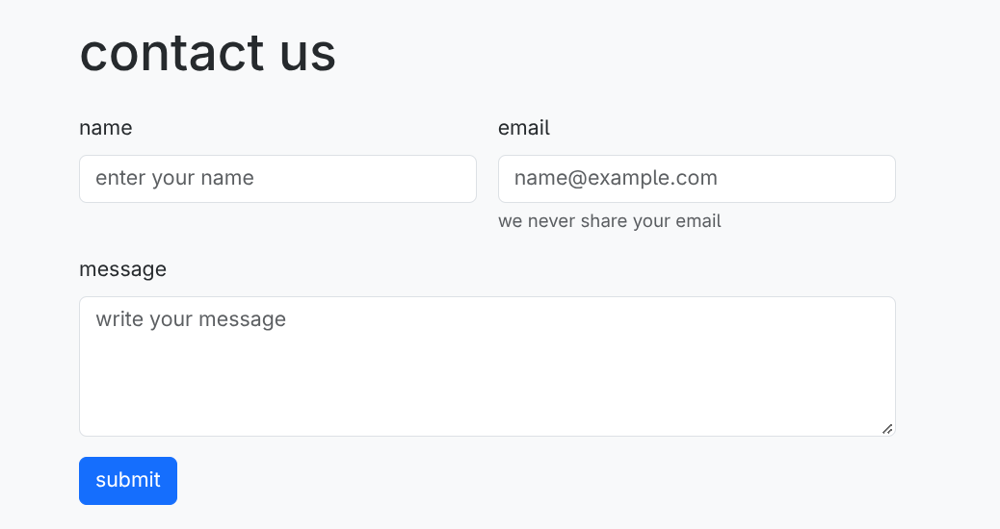
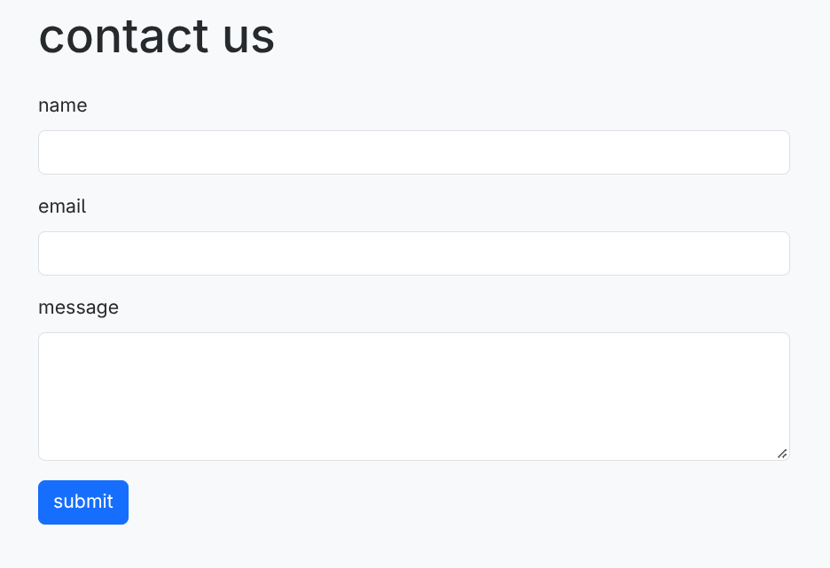
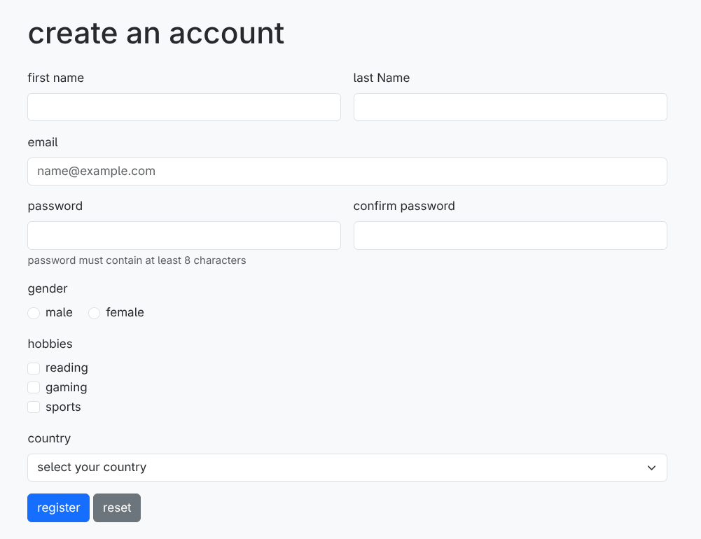

# Assignment 4 - Forms and Validation

**Name:** Aldiyar Kairollin  
**Group:** SE-2539

## Introduction

The goal of this assignment is to create user-friendly HTML forms, apply Bootstrap styling, and implement form validation using HTML5 and JavaScript.

## Task 0 - Simple Contact Form

Created a basic contact form with name, email, and message fields, along with a submit button. Added labels for all inputs and custom CSS styling to improve the form's appearance.

## Task 1 - HTML5 Validation

Added HTML5 validation attributes such as `required`, `minlength`, and `maxlength` to validate user input. The email field uses `type="email"` to check the email format, while the browser provides built-in validation messages.

## Task 2 - Bootstrap Form Styling

Recreated the contact form using Bootstrap form components and the Bootstrap Grid system. Added placeholders, helper text, and responsive layout classes to make the form easier to use on different screen sizes.

## Task 3 - Bootstrap Validation Styles

Applied Bootstrap validation classes `is-valid` and `is-invalid` to indicate whether the entered data is valid. Used JavaScript and HTML5 validation methods to display feedback messages and check the form before submission.

## Task 4 - Registration Form

Created a responsive registration form with first name, last name, email, password, password confirmation, gender, hobbies, and country fields. Implemented input validation, password matching, success and error feedback, and Submit and Reset buttons.

## Conclusion

During this assignment, I practiced creating HTML forms, applying CSS and Bootstrap styling, and implementing HTML5 and JavaScript validation. I also learned how to provide feedback for invalid and valid input and create a responsive registration form.

